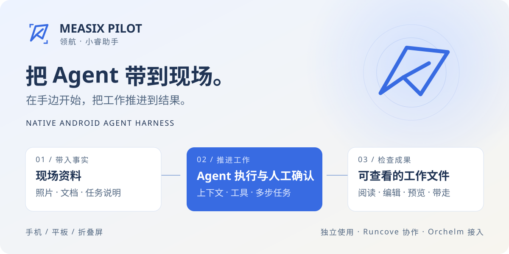
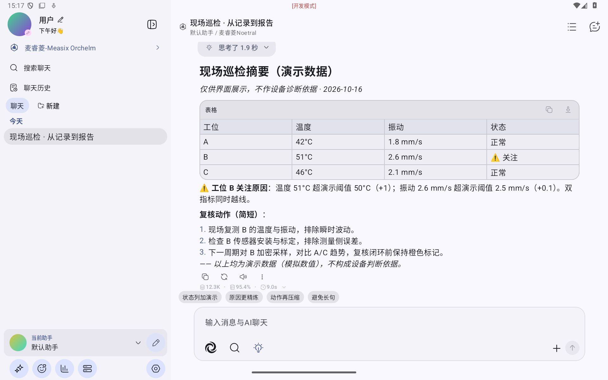
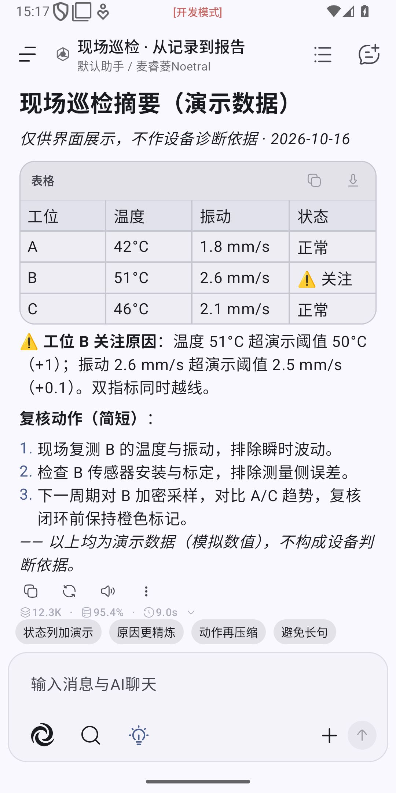
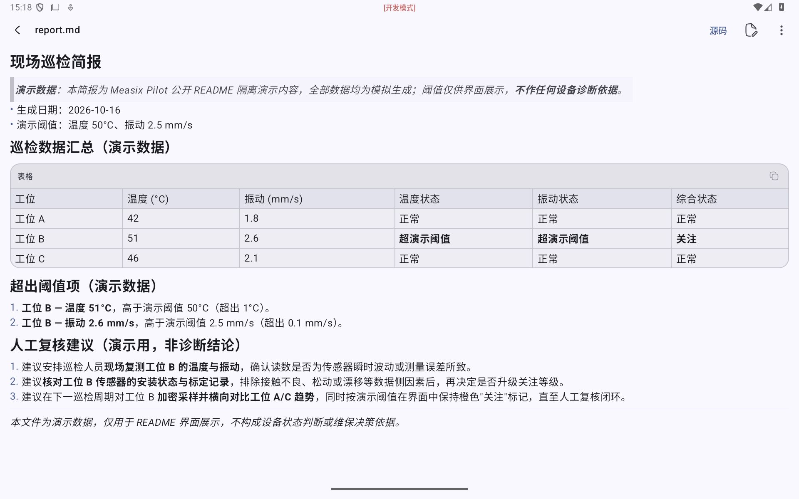
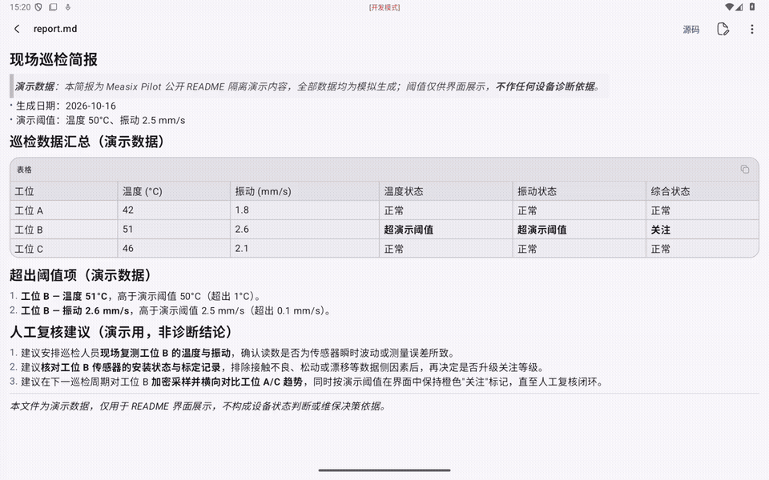
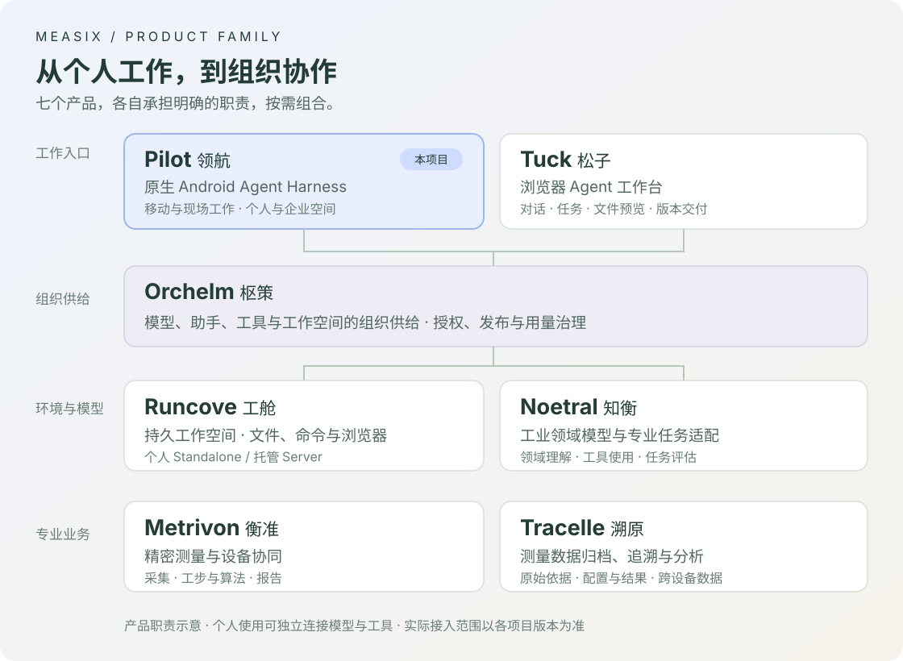

<div align="center">

# Measix Pilot · 领航

**把 Agent 带到现场，把工作推进到结果。**

原生 Android Agent Harness · 小睿助手<br>
在手机、平板与折叠屏上，带入资料、调用工具、确认关键步骤，检查并带走成果。

[官网](https://measix-pilot.weero.net/) · [开始使用](#开始使用) · [工作体验](#在移动端完成一整段工作) · [上下文与工具](#为长任务安排上下文与工具) · [连接 Runcove](#连接-runcove把计算与文件留在远端) · [Measix 七大产品](#measix-七大产品) · [开发文档](#开发与文档)

</div>



<p align="center"><sub>产品工作流示意，非应用截图。</sub></p>

Pilot 在 Android 本地承接 Agent 的运行与交互：从模型请求、多步工具执行，到人工审批、子助手、文件处理与执行记录，组成完整的原生工作流程。你可以独立配置自己的模型和工具，也可以接入组织的 **Orchelm**，使用已发布的助手、资源与经验。

项目源自 [RikkaHub](https://github.com/rikkahub/rikkahub)，在其原生聊天体验的基础上，持续面向**长任务、移动与现场工作、宽屏与折叠屏、多模态资料、上下文管理和企业协作**演进。这里的“小睿助手”是亲切的中文昵称，产品名称为 **Measix Pilot**。

## 在移动端完成一整段工作

<p align="center">
  <a href="docs/assets/readme/chat-wide.png"></a>
  <a href="docs/assets/readme/chat-phone.png"></a>
</p>

**同一项工作，在手机上跟进，在宽屏上展开。** 上图为当前源码 Debug 版的 Android 模拟器实拍：通过 Orchelm 调用真实模型，使用 Runcove 工具生成文件，再整理为现场摘要。巡检数值均为演示数据；点击图片查看原图。

### 带着现场资料开始

一张照片、一份 PDF、一段需求，都可以成为任务的起点。多模态输入、文档解析、按需附件识别与图片生成，让资料进入对话，也让产物留在工作流程中。通过 Starter 选择任务入口，检查预填内容后再发送；常用方法还可以整理为 Skills，供助手按需使用。

例如，在现场带入设备照片与作业说明，让助手整理问题、查询获准资料、处理数据，再生成待复核的说明或报告。具体识别、生成和执行能力由所配置的模型、工具与权限决定。

### 让多步任务有过程，也有确认

Pilot 支持连续模型采样与工具执行，展示流式回答、工具过程和子助手结果。需要人工批准或补充信息时，在当前任务中回应后继续；执行检查点、结果与会话历史一起保存，便于回看发生了什么。

切换页面或将应用置于后台时，任务可继续运行，并通过前台通知返回；点击停止会取消执行并清理相关资源。后台运行仍受 Android 系统限制；若应用进程被终止，重启时会标记未完成的执行，不会自动续跑。

### 手机顺手，展开也好用

Kotlin / Jetpack Compose 原生界面以移动操作为起点：动作按需展开，输入、审批与文件操作保留清楚的归属。窄屏聚焦当前工作，宽屏聊天展开为会话列表与详情双栏；折叠屏依据真实铰链和姿态分区，矮横屏使用紧凑输入，弹层随可用空间调整。

长回答支持 Markdown、代码高亮、LaTeX 与 Mermaid；消息分支、全文搜索和历史回看帮助你找到之前的判断。布局依据窗口实际宽高调整，适应平板、多窗口和折叠状态变化。

### 文件可以直接检查和处理

文件管理覆盖本地 Workspace、个人 WebDAV 与企业远程工作区。查看目录、筛选与批量选择、上传下载、编辑文本和源码，让资料处理紧接着任务进行。

| 工作对象 | 可以怎样处理 |
| --- | --- |
| 文本与源码 | 阅读、语法高亮、编辑与保存；远程写入检查版本冲突 |
| 图片与 PDF | 图片查看、PDF 逐页预览与缩放 |
| 音视频 | 在支持的文件服务上按需读取与播放，避免为预览复制整个大文件 |
| 本地程序与资料 | 初始化 PRoot Linux 环境，在工作目录中使用文件工具、Shell 与终端 |
| 企业远程文件 | 在原空间授权下浏览、传输、编辑、预览与导出 |

不同文件入口的格式与大小限制见 [Workspace 与文件服务](docs/references/workspace-architecture.md)。HTML 当前以源码查看；远程文件管理不等于远程终端，远端程序执行由已接入的工具提供。



模型在独立演示目录中生成 `inspection.csv`、`report.md` 与 `chart.svg`；上图是从企业远程工作区打开的实际报告。

<details>
<summary>观看操作演示：报告预览 → 源码 → 文件列表 → 图表</summary>



真实模拟器操作录屏，1.25 倍速、无声；展示已生成文件的检查过程。[查看 MP4](docs/assets/readme/walkthrough.mp4) · [素材来源与更新方式](docs/assets/readme/README.md)

</details>

## 为长任务安排上下文与工具

多步工作不仅需要模型能力，也需要稳定、可追溯的输入。Pilot 把上下文装配、工具选择与历史处理放进同一条执行链。

- **上下文有来源。** 开场、系统指令、附件、记忆与应用补充内容保留各自来源和因果位置；可查看上下文变化，历史输入不会随着当前设置被重新编造。
- **同一轮保持输入稳定。** 普通配置、系统指令、模板变量与工具定义在任务轮次开始时确定，后续步骤、重试和交互继续复用，减少不必要的提示词缓存前缀变化。
- **工具按实际能力装配。** 根据助手配置、模型能力、工作区就绪状态、Skills 与 MCP 授权选择工具，避免把所有工具一股脑塞进每次请求；企业网关支持发现与调用入口。单轮工具定义保持稳定，执行时仍检查当前权限。
- **历史工具输出滚动压缩。** 对成功请求已经消费的历史结果，在保护近期内容的前提下归档长正文，保留回查入口，降低后续请求的输入负担。
- **记忆与权限保持新鲜。** 运行记忆和可见助手目录在新请求边界按当前权限读取与对账；冻结输入不会让过期权限继续生效。

上下文长度控制优先于缓存前缀稳定；压缩历史正文可能使缓存失效，实际命中以模型服务返回的缓存读取量为准。当前支持手动会话摘要，尚无自动会话摘要或按模型窗口自动裁剪。机制详见 [请求上下文](docs/references/request-context.md)、[提示词与工具](docs/references/prompts-and-tools.md)和 [MCP](docs/references/mcp-architecture.md)。

## 独立使用，也能进入组织工作

### 个人使用：自己的模型、工具与资料

配置支持的 Provider，选择模型和助手即可开始。按任务需要启用搜索、MCP、Skills 或本地 Workspace；个人使用无需部署 Orchelm。会话和配置保存在设备上，模型请求与工具调用发送到你配置的服务。备份支持 WebDAV / S3。

Provider 覆盖 OpenAI、Gemini、Claude、DeepSeek 及相应兼容接口，包含 Chat Completions 与 Responses 路径；各协议能力以 [Provider 参考](docs/references/protocol-reference.md)为准。

### 连接 Runcove：把计算与文件留在远端

[**Measix Runcove · 工舱**](https://github.com/topabomb/measix-runcove) 是自托管的持久工作空间，提供文件、程序执行、浏览器与可人工接管的桌面。Pilot 承接移动交互，Runcove 承接远端环境：在手机上提交任务和确认步骤，让工具在空间中处理资料，再检查生成的文件。

在 Pilot 配置 Runcove 提供的 HTTP MCP 地址与认证，选择允许使用的助手和工具。Standalone 使用 `/mcp`，Server 使用分配给用户的入口；部署与凭据见 [Runcove 部署指南](https://github.com/topabomb/measix-runcove/blob/main/docs/deployment.md)。MCP 提供执行工具，文件浏览另需配置 WebDAV 或接入企业工作区，桌面接管使用 Runcove 自身入口。

### 接入 Orchelm：复用组织的资源与经验

**Measix Orchelm · 枢策** 为企业或组织管理身份、模型、工具、助手与工作空间，并发布可复用的方法和经验。使用组织提供的接入材料后，Pilot 在企业空间中使用获准能力，现场员工可以带入任务事实、调用企业工具、处理共享工作资料并确认结果。

个人与企业空间保留各自的历史、记忆和文件边界。受管助手的指令与固定工具由组织维护；允许时可选择获准的企业模型或自有模型。模型、工具与文件访问持续受原空间授权约束。接入与配置规则见 [配置架构](docs/references/android-configuration-architecture.md)和 [助手配置](docs/references/assistant-configuration.md)。

同一产品家族的 [**Measix Tuck · 松子**](https://github.com/topabomb/measix-tuck) 提供基于 Docker Agent 的自托管浏览器工作台，集中呈现对话、任务、文件与版本交付。Pilot 侧重原生移动与现场工作，Tuck 侧重浏览器中的任务组织；二者可按各自授权使用 Runcove 与 Orchelm 的能力，当前不表示聊天或运行任务自动跨端同步。

## 开始使用

本文随 **0.0.21** 更新；截图和演示使用 0.0.20 源码构建的 Debug 版。安装时请核对对应版本说明；也可以按下方命令自行构建。

1. 从本仓库的 [Releases](https://github.com/topabomb/rikkahub_mcp/releases) 查看可用发行与版本说明，或按下方命令自行构建。支持 **Android 8.0+**，APK 面向 **arm64-v8a / x86_64**。
2. 个人使用时，启用并配置 Provider、填写自己的 API Key，选择模型与助手。首次启动的预设 Provider 默认禁用。
3. 创建会话，输入任务或添加资料；需要更多能力时再配置 MCP、Skills 和 Workspace。本地 Shell 需要先安装并初始化 Linux 环境。
4. 组织使用时，按管理员提供的材料接入企业空间，确认可用助手、模型与工具后开始工作。

## Measix 七大产品

Measix 围绕现场事实、专业能力、人的工作入口与组织治理形成七个产品。Pilot 是其中的原生移动 Agent，也可以独立使用。



| 产品 | 主要职责 |
| --- | --- |
| **领航 Pilot** · 本仓库 | 原生 Android Agent Harness，承接移动任务、现场资料、工具执行与人工确认 |
| [**松子 Tuck**](https://github.com/topabomb/measix-tuck) | 自托管浏览器 Agent 工作台，组织对话、任务、进展与交付 |
| [**工舱 Runcove**](https://github.com/topabomb/measix-runcove) | 持久远端工作空间，提供文件、程序、浏览器与桌面 |
| **枢策 Orchelm** | 企业身份、模型、工具、助手与经验的供给、授权和用量治理 |
| **知衡 Noetral** | 面向工业任务的领域模型与专业能力适配 |
| **衡准 Metrivon** | 精密测量、设备协同与确定性计算，形成可信的业务事实 |
| **溯原 Tracelle** | 测量数据归档、追溯与分析，保留原始依据和上下文 |

图中描述产品职责，按需组合；具体集成与交付范围以各产品版本为准。

## 开发与文档

使用支持仓库锁定 AGP 的 Android Studio 或命令行环境，准备 JDK 17+ 与 Android SDK 37。在仓库根目录执行：

```powershell
# Windows PowerShell
.\gradlew.bat assembleDebug --no-parallel --max-workers=1
```

macOS / Linux 使用 `./gradlew assembleDebug --no-parallel --max-workers=1`。Release 构建使用 `assembleRelease`；测试与设备场景见 [测试策略](docs/references/testing-strategy.md)，设备验证应使用专用设备。

<details>
<summary>模块与技术栈</summary>

Kotlin · Jetpack Compose / Material 3 · Navigation 3 · Coroutines / Flow · Koin · Room / DataStore · OkHttp / Ktor

| 模块 | 职责 |
| --- | --- |
| `app` | UI、应用编排、领域状态、持久化与 Android 集成 |
| `ai` | Provider 适配、线协议、消息与工具基础类型 |
| `workspace` | PRoot Linux、文件与进程执行 |
| `speech` / `search` | 语音与搜索 SDK |
| `document` / `highlight` | 文档解析与原生代码高亮 |
| `material3` / `common` | 动态配色与跨模块通用工具 |

包名为 `net.weero.measix.pilot`，Debug 带 `.debug`；最低 SDK 26，目标 SDK 37。

</details>

| 想了解什么 | 阅读入口 |
| --- | --- |
| 整体架构、职责与专题导航 | [应用架构](docs/references/application-architecture.md) |
| 会话、多步执行、审批与中断 | [Turn / Step 执行](docs/references/turn-step-execution.md) |
| 上下文、缓存与历史处理 | [请求上下文](docs/references/request-context.md) |
| 模型、助手、个人与企业配置 | [配置架构](docs/references/android-configuration-architecture.md) |
| 文件、Linux 环境与远程工作区 | [Workspace](docs/references/workspace-architecture.md) |
| 界面、自适应布局与消息显示 | [UI 架构](docs/references/ui-architecture.md) · [消息渲染](docs/references/message-rendering-pipeline.md) |
| 数据、备份与恢复 | [数据持久化](docs/references/data-persistence.md) |
| 验证、贡献约定与发行变化 | [测试策略](docs/references/testing-strategy.md) · [AGENTS.md](AGENTS.md) · [版本记录](docs/dev/changelog.md) |

## 来源与致谢

感谢 [RikkaHub](https://github.com/rikkahub/rikkahub)、原作者 [re-ovo](https://github.com/re-ovo) 及社区提供的原生 Android 聊天基础。Pilot 从 **RikkaHub v2.3.1（versionCode 164，提交 `5b9be301`）** fork，现作为 Measix Pilot 独立演进；上游同步与来源记录见 [同步总账](docs/dev/upstream-sync.md)。

感谢 Kotlin、Jetpack Compose、MCP、PRoot 及所有依赖项目的维护者。

## 许可

[AGPL-3.0](LICENSE)
