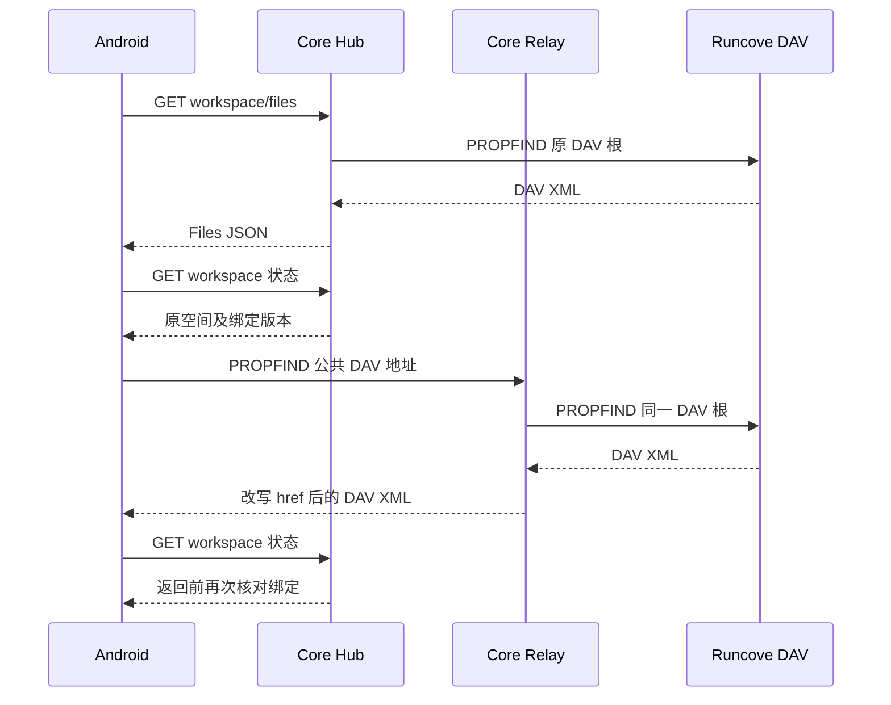

# 工作区 Files 与 WebDAV 请求效率调研

企业 Files 和企业下发 WebDAV 最终可以访问同一个 Runcove 文件系统，但客户端请求数量和 Core 中间处理并不相同。本次确认 Android 普通 DAV 网络读取比 Files 多两次串行状态请求，同时验证了 Core Relay DAV XML 转换的短写和 flush 放大。Runcove 两条入口共用同一后端处理路径，没有 Files 专用快路。

Android 已精简首次捕获目标时的一次重复状态查询。普通 IO 的两次状态往返仍保留，因为现有 DAV 协议不能表达旧句柄期待的绑定版本；进一步消除它们需要服务端条件准入支持。Core 和 Runcove 仅做只读调研，未修改或部署。

## 范围与版本

| 对象 | 本次依据 |
| --- | --- |
| Android | 本轮 `3a70812db`、`b94b545d0` 及后续审查修复 |
| Core | `D:/RustProject/measix/measix-platform-core`，`9cb59da3c38d6d02c3c0f8e7d73b51738e27a069` |
| Runcove | Ubuntu `/home/hualei/msb_demo`，`f1643e2fea3549a2d26f40261582fc7f065fb279`；入口按该仓库 README、WebDAV 和架构文档核对 |
| 真实读取 | 已接入的专用 `Pilot_Verification_API36` 模拟器，同一账号、资源、空间和平台；只读目录及状态 |
| 隔离验证 | Android 构建报告目录中的标准库 Go 程序、本机 HTTP/1.1、合成 UTF-8 XML，Go 1.26.4 |

Core 和 Runcove 调研前后工作树均干净。源码版本可以确认实现机制；生产 Hub、Relay、Runcove 二进制是否对应这些提交，尚未取得可核验的构建身份。因此，隔离基准不用于宣称生产已经获得同等收益。

## 两条请求链

Files 使用 `GET /api/client/v1/workspace/files?agentSpaceId=…&path=…`；内容读取使用 `workspace/content`。企业 DAV 使用 `/runtime/v1/resources/{resourceId}/spaces/{agentSpaceId}/dav/{path}`。

两路后台目标均由保存的 `cfg.DavOrigin` 拼接 `/u/{remoteUsername}/dav/{path}`，使用同一已确认 DAV secret 对应的 token。平台登录 Bearer 留在 Core，不传给 Runcove。对应源码入口：

- Core `backend/internal/hub/agentspace/client.go::Client.DAVURL`、`workspace/webdav.go::davRuntimeBindings`。
- Core `backend/internal/hub/httpapi/workspace.go::serveWorkspaceFiles` 与 `backend/internal/relay/runtime/webdav.go::serveDAV`。
- Runcove `agent-space/agent-space-mcp/src/webdav.rs::handle/forward_authenticated`。

## Android 请求数量和已实施修复

下表不计 token 恢复、连接恢复，以及并发状态刷新合并。

| 操作 | Files | 企业 DAV |
| --- | --- | --- |
| 已开会话的一次列表、HEAD 或 Range | 1 次文件请求；原身份在本地复验 | 1 次 DAV 加前后 2 次状态 GET |
| 首次打开并列目录 | 通常 1 次状态加 1 次列表 | 修复前 5 次状态加 1 次 DAV；修复后 4 次状态加 1 次 DAV |
| 已开页面下拉刷新 | 1 次状态加 1 次列表 | 3 次状态加 1 次 DAV |
| 目录、文本或媒体缓冲命中 | 本地原句柄复验 | 本地原句柄及已发布 DAV 投影复验 |

Android `WebDavApplicationService.operation` 在 IO 前后调用 `validate`，经 `RemoteWorkspaceService.readDavProjection` 发起 Hub `/workspace` GET；Files 的 `RemoteWorkspaceService.operation` 使用已发布原会话投影，不为每次文件请求另查状态。Hub 状态接口读取 Core 状态，不另向 Runcove 发 DAV 请求。

本次修复在 `WebDavApplicationService.observeTarget/captureTarget` 保留同次新鲜响应，首次选中页面捕获目标时复用一次，随后仍校验当前配置、原 selection 和已发布投影。若已有较新绑定，旧观察不能覆盖它。观察不跨操作保存，不引入授权 TTL；旧 Turn 目标、后台 capture、普通 IO 前后及 401 恢复仍走原远端复验。

对应行为测试验证首次捕获只读一次状态、旧目标拒绝新版本，以及较新的已发布绑定拒绝旧观察。这里减少的是打开阶段的重复查询，不能写成“普通 DAV IO 的两次状态往返已经移除”。

## 生产分层测量

在同一生产空间分别读取根目录和一个普通子目录，各按相同顺序交替五轮；冷启动首项保留，表中使用中位数。原始传输对照使用独立诊断 client，其两种协议共享 probe pool 以减小建连差异；产品 client 保持原池。原始调用仅用于分层测量，产品继续使用原应用服务。

| 层级 | 根目录 | 普通子目录 |
| --- | ---: | ---: |
| Files 完整 service 列表 | 417 ms | 409 ms |
| DAV 完整 service 列表 | 1183 ms | 1187 ms |
| 原始 Files 列表 | 416 ms | 415 ms |
| 原始 DAV 列表 | 549 ms | 544 ms |
| 独立状态查询 service | 308 ms | 309 ms |
| 原始状态 GET | 306 ms | 306 ms |
| Files 打开会话，不含列目录 | 315 ms | 316 ms |
| DAV 打开会话，不含列目录 | 635 ms | 627 ms |

普通子目录完整列表差约 778 ms；两次状态查询约 618 ms，与主要差距相符。DAV service 相对 raw DAV 多约 643 ms，也与此吻合。这是同一时间窗口的近似分解，不是逐请求跨服务 CPU 耗时分摊。

诊断响应均为 HTTP/2 和 identity。根 Files JSON 为 682 字节、有 Content-Length；DAV XML 为 3554 字节、长度未知。普通子目录分别为 1082 和 4324 字节。根 DAV 原始响应头约 384 ms 到达，EventListener 正文结束约 540 ms；子目录分别约 382 和 535 ms。

Files 在根目录过滤精确 `.agent-space` 管理项，标准 DAV 保留；普通点文件、`.agent-space-backup` 和子目录中的同名项不因这条规则被过滤。对应 Core `agentspace/client.go::protectedFilePath` 与 `agentspace/dav.go::Client.list`。补采五轮根目录均为 Files 4 项、DAV 5 项，差异只有该管理项；普通子目录五轮均为 6 项且原始集合完全一致。后者排除了根管理项过滤对请求数量归因的干扰，JSON 与 XML 自身仍是不同响应格式。

额外的 ResponseBody 包装器区分正数据读取和 EOF。它记录的是包装层观察时刻，相对响应头取得后的起点，不是网卡精确到达时间：

| 正文读取观察 | 根 Files | 根 DAV | 子目录 Files | 子目录 DAV |
| --- | ---: | ---: | ---: | ---: |
| 最后正数据读取中位数 | 1 ms | 154 ms | 1 ms | 153 ms |
| EOF 读取中位数 | 1 ms | 165 ms | 1 ms | 161 ms |
| 每轮 EOF 减最后正读的中位数 | 0 ms | 9 ms | 0 ms | 8 ms |

本次约 150 ms 的额外正文等待主要出现在正数据读取期间，不能全部归因于最后数据后的同步统计尾处理。剩余约 130 ms 的 raw Files/DAV 差距仍可能混合 Relay XML 转换、响应分块、入口转发与后端调度；当前没有逐请求服务端阶段记录来精确分摊。

## Core 已验证的 XML 放大

Relay `backend/internal/relay/runtime/webdav_xml.go::mapDAVXML` 逐 token 写出，`rewriteDAVXML` 直接连接无缓冲 `io.PipeWriter` 并将 ContentLength 置为 -1。Go `httputil.ReverseProxy` 对未知长度响应立即 flush。既有 32 KiB copy buffer 代表最大单次读取容量，并不会自动把 Pipe 的每次短写聚合成大块。

隔离程序复现该转换和标准库反代，只将对照组的 Pipe 前输出改为 32 KiB `bufio.Writer`，成功结束时 Flush。每组交替三轮，18 个输出均与直接转换逐字节一致。

| 合成子项 | 输出字节 | 原 Pipe Write | 原 HTTP Write / Flush | 32 KiB Pipe Write / HTTP Write / Flush |
| --- | ---: | ---: | ---: | ---: |
| 10 | 4,874 | 293 | 283 / 284 | 1 / 1 / 2 |
| 200 | 95,884 | 5,803 | 5,603 / 5,604 | 3 / 3 / 4 |
| 2000 | 958,084 | 58,003 | 56,003 / 56,004 | 30 / 30 / 31 |

计数是逻辑 ResponseWriter 调用，不能等同 TCP 包或 syscall；合成本机计时不用于预计生产加速比例。该机制可确定为当前 Core 版本的目录协议处理效率问题，生产影响还取决于部署版本、目录规模及入口代理。GET/HEAD 视频正文不经过 XML 重写，不能用此机制解释全部视频等待。

Relay 还有一个需要分段取证的尾部候选：`serveDAV` 返回前同步执行统计记录和 spool 持久化，未知长度正文可能等待 handler 结束。需要分别记录最后数据、EOF、proxy copy 结束和统计写入阶段，才能判断其对当前尾延迟的贡献。

## Runcove 的共同成本

两路相同 DAV 请求进入同一个 SessionManager 和 guest helper。已运行 helper 的普通请求依次执行运行准入、helper 存活检查、运行状态复验、新 guest TCP 和 HTTP/1 握手；存活检查实际执行一次 `python3 … managed.py alive`。冷启动由同一 owner 启动 helper。Host 向 guest 显式发送 `Connection: close`，没有跨请求 guest HTTP 池。

依据为 Runcove `agent-space/src/session.rs::begin_dav_request/connect_dav_guest_tcp`、`engine/msb.rs::managed_alive/managed_action` 与 `agent-space-mcp/src/webdav.rs::forward_authenticated`。GET、HEAD、PROPFIND 不进入写操作 mutation gate；GET 正文按 64 KiB 块读取并流式传递，PROPFIND 按目录项 flush。没有一条路径先完整复制文件或做 Base64 再编码。

这些成本会让多发一次 HEAD、PROPFIND 或 Range 更贵，但相同后端请求集合会共同支付，不能单独解释 Files 与 DAV 的相对差距。本次优先处理 Android 请求数量和 Core XML 写出方式，Runcove 优化应由单请求分段 profile 决定。

## 服务端修复建议

### 优先聚合 Relay XML 写出

在原 `rewriteDAVXML` goroutine 内，把 `mapDAVXML` 输出接到 32 KiB `bufio.Writer`，成功尾部 Flush；转换或 Flush 失败继续交给原 `CloseWithError`。保留原上游及 Pipe 关闭、取消、UTF-16/gzip 处理、href 校验和现有限额，不收集完整目录，也不增加目录缓存。

应验证 10、200、2000 项目录输出与原实现等价，Write/Flush 随字节块数增长；同时覆盖错误 XML、gzip、UTF-16、慢下游、取消和原 goroutine 实际退出。随后在固定部署对同一目录做原始 DAV 对照。

### 为 DAV 增加期待绑定版本条件

Relay 当前会核对 JWT、当前 binding、URL 的资源与空间，并在 binding 变化时取消已准入请求。但 URL 没有期待的 binding revision；同资源、同空间的新版本已生效后，迟到的旧句柄请求仍会按新版本准入。

若要进一步消除 Android 普通 IO 的两次状态 RTT，应定义可协商的期待绑定版本条件，在原 `Store.Register` 锁内比较并准入。版本不符使用稳定拒绝码且不转发请求；不复用文件 ETag/DAV If 条件。服务端支持且经过准入竞态测试后，Android 才能将这两次远端查询收敛到本地复验加服务端原子条件。

### 其他项先测量再调整

Relay transport 有按超时配置复用的连接池；Hub Files adapter 反而每操作创建 clone transport。因此当前源码不支持“DAV 每次新建 Android client 或没有连接池”的解释。Hub transport 复用可作为 Files 自身优化，不能用来解释当前 DAV 较慢。

Runcove 的 Python alive、运行锁和 guest 建连应先测分段耗时。若共同成本占主导，在 SessionManager 原 owner 内收敛重复检查，并保留原空间、runtime generation、撤权和取消约束；不优先引入跨身份连接池。

## 验证证据与边界

`WorkspaceReadPerformanceLiveAndroidTest` 沿原接入身份执行只读对照，输入一次消费，证据不含 token、Authorization、Cookie 或文件正文。诊断 client 独立释放。详细样本、HTTP 元信息和隔离程序保留在 Android 本地 `app/build/reports/preview/`；生产地址及资源标识不作为公开报告内容。

当前主要结论是：Android 额外状态往返解释了生产样本的大部分差距；Core XML 放大已在隔离程序得到验证；Runcove 共路不支持“底层文件系统不同”这一归因。生产剩余单请求差距仍需固定部署版本，并关联入口、Hub/Relay 与 Runcove 的同请求阶段耗时。既有 requestId 可用于关联时应复用，缺少标识时以方法、原空间、路径、Range 和同一时间窗口取证。

入口 `X-Request-Id` 与 Core `X-Measix-Request-Id` 分开记录；本次成功响应没有可用于跨 hop 串联的已采集入口 ID，不能据此推断 Core 没有内部 ID。Core 成功 DAV 响应尚未统一返回其问题响应所用的关联头。

本轮 Android 验证包括 118 项定向单元测试、75 项设备用例、Debug/Release 构建和 lint，以及根目录、普通子目录各五轮生产只读比较。Core 隔离基准保留 18 份原始输出校验。没有构建、修改或部署 Core/Runcove；Release APK 仅构建，未代替真机安装验收。

## 同轮审查修复

- 目录加载过渡使用临时滚动状态，缓存失效后的空列表测量不再将原目录位置归零。旧 APK 已复现，新 APK 验证保持原位置。
- `FileEditorBinding` 管理一个草稿的原生绑定，离页解除平台 watcher/filter 并保留正文、注解和草稿自身监听；新绑定先释放旧绑定，迟到关闭和滚动不回写新状态。旧 APK 已复现回调残留，新 APK 覆盖释放及 A→B 交接。
- HTML 识别包含 `stylesheet` 的多 token `rel`。已知几何的图片先完成占位加载再恢复滚动，离屏释放直接替换占位而不先清空 src；混合自然尺寸图片连续三次冷返回、真实图片完成前后均保持目标位置。

工具耗时、源码图标、三工作区资源预算、取消与撤权、预览编辑切换、同页锚点及文件跳转、错误关闭/手势等原变更已纳入独立审查。跨文件 `other.md#section` 目前打开目标文件顶部，同页 `#section` 支持定位；本次未扩展跨文件片段导航。
